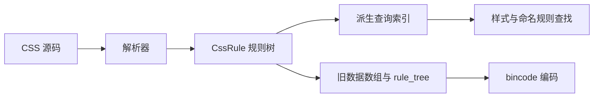

# Media Query 与规则树改动说明

本文说明 `feat/css-media-query-mq4` 分支相对 `master` 的改动、设计意图及兼容性边界。

- 记录日期：2026-10-19。
- 实现基点：`9336ffc`，并包含当前工作区的 `rpx` 支持、语义注释与编码断言补充；对比基线：`fd6671c`。
- 范围：媒体条件解析与求值、样式表规则树、bincode 编码、C 结构，以及相关内存与边界处理。

这次改动用表达式树描述复杂媒体条件，用规则树记录各种规则的顺序和嵌套关系，同时保留旧版二进制数据的字段前缀。新旧版本之间能够读取相应的 bincode，不代表旧引擎能够执行新增语义。

**当前仍有一项已确认的问题尚未修复：媒体条件中的 `Length / CalcExpr` 反序列化可以绕过 64 层表达式深度限制。** 已完成的防护和待修复范围见“深度限制与输入校验”。

## 1. 为什么改

原有运行时结构主要按规则类型分别保存数据：普通样式规则记录 `Rule.media`，媒体条件通过 `Media.parent` 串联；`@font-face`、`@keyframes` 和 imports 分别保存。

这种结构可以表达普通样式规则受哪些媒体条件控制，但不能完整记录规则之间的包含关系和交错顺序。具体问题包括：

| 原有表达能力 | 缺失的信息或行为 |
| --- | --- |
| 普通规则指向媒体条件 | 没有普通规则的空媒体组难以保留 |
| `@keyframes` 单独保存 | 无法保留其所属媒体组，查找时不能按该组条件筛选 |
| `@font-face` 单独保存 | 无法保留其所属媒体组，读取结果缺少环境筛选能力 |
| 各种规则分别保存 | 无法完整还原不同类型规则之间的源码顺序 |
| 媒体查询保存为条件列表 | 难以表达嵌套的 `not / and / or` 和范围比较 |

设计目标是同时满足三件事：规则关系表达完整、查询仍使用索引、历史编译产物仍然可读。

## 2. 媒体查询改了什么

媒体条件解析集中到 [src/parser/media.rs](../src/parser/media.rs)，表达式和求值位于 [src/sheet/media.rs](../src/sheet/media.rs)。原有媒体类型、尺寸、方向、主题条件继续保留；新增和修正的能力如下。

| 能力 | 当前支持范围 | 示例 |
| --- | --- | --- |
| 媒体类型与修饰符 | `all`、`screen`；`not`、`only` | `screen and (max-width: 375px)` |
| 尺寸条件 | `width / height` 及其 `min- / max-` 形式 | `(min-width: 768px) and (max-width: 2048px)` |
| 条件组合 | 带括号的嵌套 `not / and / or`、逗号查询列表 | `(width > 800px) or (height > 600px)` |
| 范围比较 | `= / < / <= / > / >=`、值在左侧、双边范围 | `(320px <= width < 768px)` |
| 布尔上下文 | 尺寸、方向、主题、分辨率等已识别特性 | `(width)`、`(resolution)` |
| 方向与主题 | `portrait / landscape`、`light / dark` | `(prefers-color-scheme: dark)` |
| 分辨率 | `resolution` 及其 `min- / max-` 形式、范围比较、`infinite` | `(min-resolution: 3dppx)` |
| 分辨率单位 | `dppx / x / dpi / dpcm` | `(resolution >= 288dpi)` |
| 长度单位 | `px / em / rem / rpx / vw / vh / vmin / vmax / in / cm / mm / q / pt / pc` | `(width >= 50em)` |
| 兼容别名 | 无前缀的 `device-pixel-ratio` 及其 `min- / max-` 形式 | `(min-device-pixel-ratio: 3)` |

这里列出的是当前实现范围，不代表完整实现了所有 Media Queries 特性。`print`、`hover`、`pointer`、`aspect-ratio` 等没有对应的环境求值支持；`-webkit-min-device-pixel-ratio` 没有专门支持。媒体长度解析当前只接受上表列出的字面量，不接受 `calc()`、`env()` 或百分比。

`rpx` 沿用普通样式中的换算规则：`1rpx = 视口宽度 / 750`。用于高度条件时也以视口宽度为基准；冒号形式和范围比较均支持。

例如，下列查询列表可以通过第二个分支匹配，不能据此认定第一个带前缀的分支已得到支持：

```css
@media (-webkit-min-device-pixel-ratio: 3), (min-device-pixel-ratio: 3) {}
```

### 条件组合与未知值

表达式新增 `Not`、`And`、`Or`、`Range` 等变体，内部使用 `True / False / Unknown` 三值逻辑。最终只有 `True` 会使查询匹配。

| 运算 | 结果 |
| --- | --- |
| `not Unknown` | `Unknown` |
| `False and Unknown` | `False` |
| `True or Unknown` | `True` |

因此，`not (unknown-feature: 1)` 不会因为特性未知就变成匹配；`(unknown-feature: 1) or (width: 800px)` 则可以由有效分支决定结果。整条查询的 `not` 修饰符在全部条件组合之后求反。

语法解析保留组合规则的约束，例如混合 `and / or` 需要相应的括号结构。它没有把所有表达式当作具有通用运算符优先级的布尔语言处理。

逗号列表中的非法项独立恢复为不匹配项，其他有效项仍然参与匹配，包括 `screen,` 中的 `screen`。已识别特性的非法值会产生诊断；解析器回退到另一种语法解释时，会撤销被放弃路径产生的警告。

### 数值处理

尺寸值按媒体环境中的视口和基础字号换算；绝对长度归一化为 px。分辨率归一化为 dppx，其中 `dpi / 96`、`dpcm * 2.54 / 96`。

负长度仍参与比较，例如 `(min-width: -1px)` 可以匹配。负分辨率字面量在单位换算前被拒绝，避免极小负值换算后下溢成零而被接受。

数值相等比较允许一次 `f32` 舍入量级的差异，用于吸收单位换算误差，没有使用固定的 CSS 单位容差。

## 3. 运行时结构：规则树作为数据来源

[src/sheet/mod.rs](../src/sheet/mod.rs) 中增加统一的规则类型：

```rust
enum CssRule {
    Style(Rc<Rule>),
    Media(Rc<MediaRule>),
    KeyFrames(Rc<KeyFrames>),
    FontFace(Rc<FontFace>),
    Import(Rc<ImportRule>),
}

struct MediaRule {
    media: Rc<Media>,
    rules: Vec<CssRule>,
}

struct StyleSheet {
    rules: Vec<CssRule>,
    index: StyleSheetIndex,
}
```

`StyleSheet.rules` 按源码顺序保存规则。媒体组持有子规则，子规则可以继续包含媒体组。`@keyframes` 和 `@font-face` 因而能够与普通样式规则一起保留在所属媒体组中。

`StyleSheetIndex` 从树中派生普通规则列表、字体列表、带媒体条件的关键帧列表、import 列表和类名索引。普通规则继续保留 `Rule.media`，媒体条件也继续保留父链，供现有匹配路径和旧格式使用。



`CompiledStyleSheet` 不再单独持有 imports；依赖查询和链接从规则树派生的 import 索引读取，避免同一份依赖关系维护两处来源。

### 对外行为

- 普通样式匹配继续使用派生索引，按树中的源码顺序分配规则序号。
- 同名 `@keyframes` 从后向前查找，并检查所属媒体组、import 条件和样式作用域。
- 原有 `get_font_face` 保持获取全部定义的行为；新增 Rust 接口 `get_font_face_with_media` 按当前媒体环境筛选。
- 样式表文本输出保留媒体组、命名规则和交错顺序；`@import` 仍不包含在该文本输出中。
- 添加、替换普通规则和添加标签名前缀后，重新建立派生索引。替换嵌套规则时保留前后规则的相对顺序，并使用替换规则自己的媒体条件。

这些变化没有增加新的 C 查询函数。

## 4. 用一个例子说明三种表示

```css
.root { width: 1px; }
@media screen and (min-width: 768px) {
    .wide { width: 2px; }
    @media (prefers-color-scheme: dark) {
        @keyframes fade { to { opacity: 1; } }
        @font-face { font-family: ThemeFont; src: local(ThemeFont); }
    }
}
.after { height: 3px; }
```

### Rust 运行时

```text
StyleSheet.rules
├── Style(.root)
├── Media(screen and min-width: 768px)
│   ├── Style(.wide)
│   └── Media(prefers-color-scheme: dark)
│       ├── KeyFrames(fade)
│       └── FontFace(ThemeFont)
└── Style(.after)
```

内层关键帧和字体同时受到两个媒体组的限制。空媒体组也能作为树节点保留。

### C 可访问结构

[src/sheet/borrow.rs](../src/sheet/borrow.rs) 中的 `RuleTreeNode` 具有实际的嵌套 children：

```rust
enum RuleTreeNode {
    Style(usize),
    Media {
        media_index: usize,
        children: Array<RuleTreeNode>,
    },
    KeyFrames(usize),
    FontFace(usize),
    Import(usize),
}
```

该例对应的结构为：

```text
[
  Style(0),
  Media { media_index: 0, children: [
    Style(1),
    Media { media_index: 1, children: [
      KeyFrames(0),
      FontFace(0)
    ] }
  ] },
  Style(2)
]
```

叶子节点的索引引用同一样式表中的原有分类数组；`media_index` 引用 `media` 数组。`Media.parent_index` 继续表示父条件的数组下标，它可以被多个子节点共用，不是全局唯一标识。

### bincode 内部编码

二进制中的私有 `SerializedRuleTreeNode` 使用前序序列，媒体节点保存 `(media_index, direct_children_count)`：

```text
[
  Style(0),
  Media(0, 2),
  Style(1),
  Media(1, 2),
  KeyFrames(0),
  FontFace(0),
  Style(2)
]
```

这里的 `2` 是直接子节点数量。`Media(0, 2)` 的两个子节点是 `Style(1)` 和 `Media(1, 2)`，不包含内层媒体组中的两个叶子。

二进制编码与 C 内存结构分别维护：前者保留稳定的前序格式，后者直接表达嵌套数组。前序格式也避免了直接递归反序列化嵌套数组。解码时先校验平铺数据，再用显式栈恢复嵌套的 `RuleTreeNode`。C 调用方读取 children 即可，不需要处理这个计数。

## 5. bincode 如何兼容

兼容基线为 `master`（`fd6671c`）。本分支未发布的中间结构和 JSON 名称不属于兼容承诺。

### 保留 V1 和原有字段前缀

顶层仍然是 `StyleSheet::V1`，没有引入 `StyleSheetV2`。V1 原有八个字段的顺序和编码形状保留：

```text
buf
imports
imports_media
rules
media
version
font_face
keyframes
```

存在规则树时，在它们之后追加两个编码项：

```text
rule_tree_encoding_version = 1u8
Vec<SerializedRuleTreeNode>
```

内存里的字段是 `Nullable<Array<RuleTreeNode>>`，实际序列化通过自定义实现输出上述“编码版本与前序节点序列”，二者不是直接对应的派生 serde 布局。

原有规则、条件、字体、关键帧和 imports 数组仍保存完整载荷；`rule_tree` 补充规则类型、索引、归属和顺序。新版本读取这些载荷，再通过 `rule_tree` 组装完整结构。

### 新版本读取旧数据

旧数据没有规则树扩展时，新版本根据普通规则的 `media_index` 和媒体条件的 `parent_index` 重建分组。

旧格式没有保存的内容无法恢复：字体和关键帧按旧语义作为顶层规则处理；空媒体组以及跨类型的原始交错顺序无法凭空补齐。

### 旧版本读取新数据

仓库使用的 `float-pigment-consistent-bincode` 支持按编码段长度跳过未读取的扩展部分，因此旧版本能够读取原有字段，并跳过尾部规则树。这个结论针对本仓库的格式和已验证版本，不是对任意 bincode 实现的承诺。

媒体表达式的新增变体追加在原有枚举末尾，原有变体的编号和载荷不变。可换算为 px 的冒号尺寸条件继续写入旧的 `Width / MinWidth / MaxWidth` 等变体，以尽量保留旧引擎可以理解的表示。

| 读取方向 | 数据读取 | 语义边界 |
| --- | --- | --- |
| 新引擎读旧产物 | 已验证可读 | 按旧产物包含的信息重建；求值使用当前实现，包含本次行为修正 |
| 旧引擎读新产物 | 已验证可读 | 忽略规则树，无法执行未认识的媒体表达式及新增嵌套归属 |
| 新引擎读新产物 | 读取载荷和规则树 | 保留本次实现支持的分组、源码顺序及条件 |

**格式兼容不保证语义兼容。** 旧引擎忽略新增条件时，规则可能意外成为无条件匹配；媒体组内的字体和关键帧可能按全局定义处理。即使使用原有语法，整条查询的 `not` 和未知值处理等修正也可能使新旧引擎结果不同。需要新增语义的编译产物应配套支持它的引擎版本。

## 6. C 接口和头文件

本次没有增加 FFI 函数，现有函数签名保持不变。C 可访问的数据结构发生了扩展：

- `StyleSheetV1` 增加 `rule_tree`。
- 增加带嵌套 children 的 `RuleTreeNode`。
- 增加媒体表达式及比较相关类型。

因此，bincode 的跨版本可读性不能替代 C 结构布局兼容性；调用方需要使用与库匹配的生成头文件。

已同步的生成文件为 `float-pigment-css/float_pigment_css.h`、`float-pigment/float_pigment_types.h` 和 `float-pigment/float_pigment_layout.h`。生成器同时处理 C++ 关键字成员名 `not / and / or`，并兼容 `extern "C"` 结束标记的空白差异。

从仓库根目录生成独立 CSS 头文件：

```sh
cargo run --offline -p float-pigment-css --bin float_pigment_css_cpp_binding_gen_tool --features build-cpp-header
```

生成聚合头文件：

```sh
cargo run --offline -p float-pigment --bin float_pigment_cpp_binding_gen_tool
```

## 7. 深度限制与输入校验

### 已实现

媒体表达式和媒体组分别设置 64 层上限。该值是 fp 的实现资源限制。逻辑表达式的自定义 `DeserializeSeed` 在进入下一层之前检查深度，避免派生 `Deserialize` 在构造完成之前已经耗尽线程栈；原有枚举编号和载荷形状保持不变。

规则树解码先检查媒体父下标、父链深度、规则引用、直接子节点数量、分类数组中的顺序与覆盖情况，以及规则归属的一致性。媒体父下标必须引用前面已有的项；扩展中非法的引用、顺序或不完整的树结构返回错误。校验通过后再恢复嵌套树。

`float-pigment-consistent-bincode` 跳过编码段时改为检查切片范围，越界返回 `UnexpectedEof`，避免截断输入触发切片 panic。

已有小栈测试覆盖逻辑表达式和规则树的边界。逻辑表达式在 512 KiB 线程栈上验证 64 层可解码、求值和销毁，65 层及更深的逻辑输入安全返回错误。

### 已确认但尚未修复

`MediaExpression::Sized` 和 `Range` 中的 `Length` 仍通过普通派生反序列化读取，未继承逻辑表达式的深度预算。构造数据可以经过以下路径继续递归：

```text
MediaExpression
  → Length::Expr
  → LengthExpr::Calc / Env
  → CalcExpr / Length
  → Number::Calc / Angle::Calc / 其他 CalcExpr 子节点
```

此前 review 已复现：256 层计算表达式被接受；约 24 KiB、包含 2048 层计算表达式的输入可使 512 KiB 栈上的公开样式表读取入口发生栈溢出。这不由当前媒体长度源码解析器生成，但可以由构造的 bincode 触发。

后续修复应将 64 层预算沿上述递归路径传递，在读取下一层之前拒绝超限输入，并覆盖读取失败时的清理。并列节点数量不计为嵌套深度。需要补充完整路径的 64 / 65 层边界和 2048 层小栈回归测试；这项修复尚未包含在本文对应的实现版本中。

## 8. 零拷贝与字符串生命周期

新结构的校验和失败返回扩大了需要正确释放输入缓冲区的路径，相关处理集中在 [src/sheet/str_store.rs](../src/sheet/str_store.rs)、[src/sheet/borrow_resource.rs](../src/sheet/borrow_resource.rs) 和 [src/ffi.rs](../src/ffi.rs)。

- 字符串缓冲区区分 `Owned(Vec<u8>)` 与保存指针、长度、释放回调的 `Borrowed`，借用外部数据时不构造虚假的拥有型容器。
- 输入至少保留到整个解码流程完成，包括失败后的编码段跳过；成功后，字符串引用仍可延长其生命周期，释放回调只执行一次。
- JSON 数值数组形式的字符串缓冲区使用自有存储；样式表和 import index 共用读取处理。
- FFI 读取入口在可能释放输入之前复制 path，避免 path 和输入共享分配时出现悬空引用。
- 版本查询接口返回独立持有的字符串，输入释放后仍然有效。

## 9. 改动位置

| 位置 | 主要改动 |
| --- | --- |
| `src/parser/media.rs`、`src/parser/mod.rs` | 媒体语法解析、诊断恢复、构建各种规则的树结构 |
| `src/sheet/media.rs` | 表达式类型、三值求值、单位比较、自定义有界逻辑表达式反序列化 |
| `src/sheet/mod.rs`、`src/sheet/rule.rs` | 运行时规则树、派生索引、规则编辑和文本输出 |
| `src/sheet/borrow.rs` | C 可访问树、兼容字段前缀、前序编码、校验及恢复 |
| `src/group.rs` | 增加按媒体环境读取字体的 Rust 接口 |
| `src/sheet/str_store.rs`、`src/sheet/borrow_resource.rs`、`src/ffi.rs` | 缓冲区所有权、释放时机和 FFI 字符串生命周期 |
| `float-pigment-consistent-bincode/src/de/read.rs` | 截断编码段的边界检查 |
| 两处头文件生成器及三个生成头文件 | 新类型输出、C++ 关键字和聚合头文件处理 |
| `tests/media.rs`、`tests/style_sheet_group.rs`、`tests/property/mod.rs`、相关单元测试 | 查询语义、嵌套命名规则、往返、诊断与内存边界回归 |

表中 `src/` 和 `tests/` 默认相对于 `float-pigment-css`。

## 10. 验证记录与性能取舍

本次整理文档时重新执行：

```sh
cargo test -p float-pigment-css -p float-pigment-consistent-bincode --offline
```

结果为 440 项通过、0 项失败、3 项忽略，其中媒体查询集成测试 28 项、样式表组集成测试 19 项。`rpx` 回归覆盖不同视口宽度下的宽高条件、范围比较、文本往返及 bincode 往返。

同一实现此前 review 的验证还包括：

| 验证 | 结果与范围 |
| --- | --- |
| 严格 Clippy | `cargo clippy --offline -- -D warnings` 通过 |
| JSON 样式表组测试 | 开启 `serialize_json,deserialize_json` 后的目标测试 19 项通过；不代表所有 JSON 测试均通过 |
| AddressSanitizer | `sheet::` 相关单元测试 17 项通过 |
| 历史 bincode | 17 份完整历史样式表通过自有与零拷贝读取及计算属性断言 |
| 与 master 双向读取 | 旧、新产物交叉读取，并检查媒体条件、嵌套规则等行为；已确认上述语义差异 |
| C++17 | 独立头文件及聚合头文件均通过编译，并实际访问 FFI 返回的嵌套 children |

新增的常规回归用例保存在仓库测试中；部分跨版本和 C++ 验证使用 review 期间的本地探针。测试通过不覆盖“尚未修复”中记录的计算表达式深度绕过。

性能方面，普通规则查询仍走索引；规则树主要用于保存结构和建立索引。代价包括树节点、分类索引、二进制中的规则树元数据，以及序列化和恢复时的遍历与临时分配。规则编辑后也需要重建索引。当前没有基准测试证明整体性能优于旧实现，本次改造的主要收益是表达能力、条件语义和结构可维护性。

## 11. 规范术语与代码命名

W3C 定义媒体查询的语法与行为，没有规定 Rust 枚举名称。保留当前代码名称，通过注释说明与规范的对应关系：

| 原名称 | 当前 Rust 名称 | 规范对应 |
| --- | --- | --- |
| `Sized` | 保留 `Sized` | 宽高特性的 `name: value` 形式；载荷限定为 `SizedFeature` 和 `Length` |
| `Boolean` | 保留 `Boolean` | boolean context、`<mf-boolean>` |
| `Range` | 保留 `Range` | range context、`<mf-range>` |
| `ResolutionRange` | 保留 `ResolutionRange` | range context 在分辨率载荷上的具体表示 |
| `MediaTypeDecorator` | 保留 `MediaTypeDecorator` | 对应 media query modifier，保留 master 中已有的代码名称 |
| `Theme(Theme)` | 保留 `Theme(Theme)` | 保留 master 的变体及值类型，对应 `prefers-color-scheme` 特性 |

`<mf-plain>`、`<mf-boolean>` 和 `<mf-range>` 来自 [Media Queries Level 4 的正式语法](https://www.w3.org/TR/mediaqueries-4/#syntax)，`prefers-color-scheme` 来自 [Media Queries Level 5](https://www.w3.org/TR/mediaqueries-5/#prefers-color-scheme)。`<mf-plain>` 涵盖各种 `name: value` 形式；当前 `Sized` 仅表示宽高与长度值，保留此名称更准确。`ResolutionRange` 中的类型前缀用于区分实现载荷，不是独立的规范语法类别。

master 中已有的 `Theme(Theme)` 变体、`MediaTypeDecorator` 类型及 `decorator` 字段直接保留，原有变体的编号、顺序和载荷保持一致。master 没有 `Sized / Boolean / Range / ResolutionRange`，这些新增变体使用相同名称作为 JSON 名称。`Boolean` 和两个 `Range` 变体使用简短名称，通过注释解释对应的 boolean context 和 range context。

现有兼容检查宏继续检查 master 的原有类型和变体。生成的 C 头文件同步 Rust 名称与语义注释，此次术语整理不再重命名类型、变体或字段。

对 master 的验证使用分别编译的 master 与当前分支读取器：两个方向各读取 18 份 bincode，11 个已支持查询在三组视口尺寸下的结果一致。未知媒体类型另外验证了 master 匹配、当前分支不匹配的既有语义差异。新增特性在旧引擎中的语义降级仍按“bincode 如何兼容”中的边界处理。

与术语整理前的 28 组产物对比，bincode 和 JSON 的名称及载荷均保持一致。master 已有的 `Theme` 名称保持不变。

完整样式表 JSON 读取存在原有的 `SelectorFragment` 错误；JSON 验证仍区分表达式级往返和完整样式表读取，不将后者计为成功。
